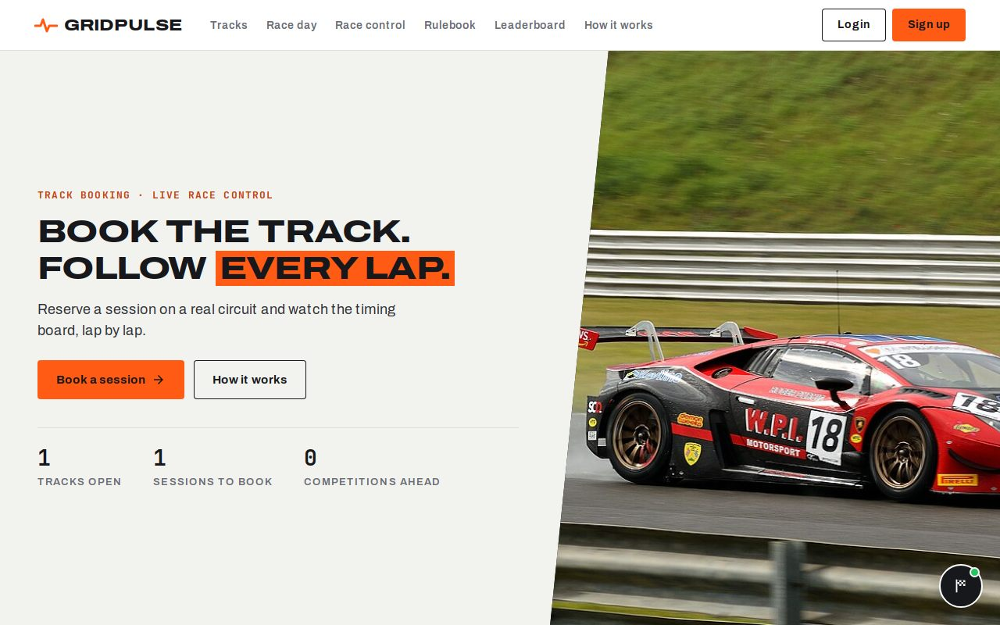
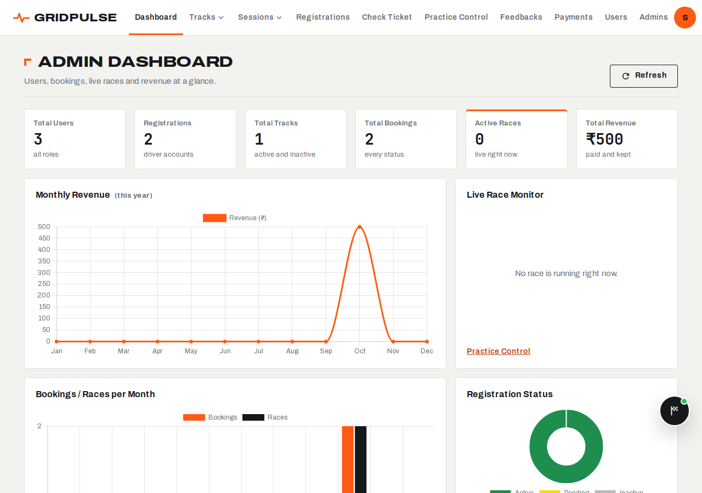
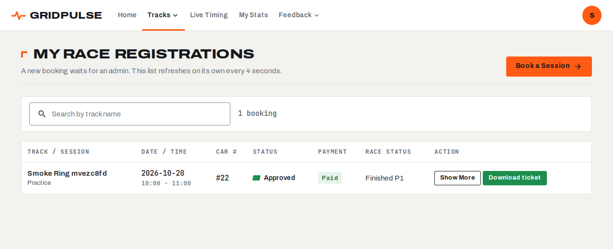
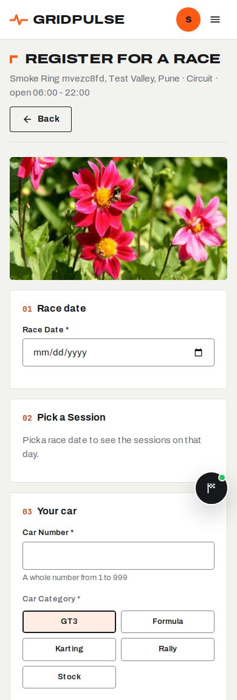
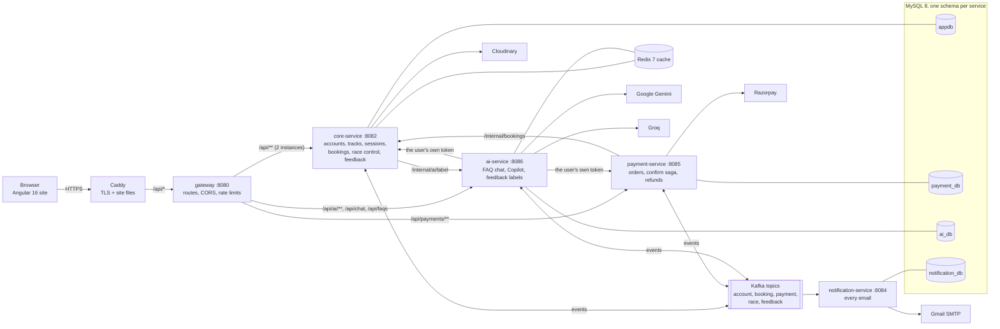

# GridPulse


<!-- live link added after the first deploy -->
<!-- Live: https://<domain> -->

GridPulse is a booking and race-control system for motorsport tracks. Drivers pick a session on a circuit, pay
online and get an e-ticket by email. Admins approve bookings, run qualifying and races and count laps, and anyone
can watch a live timing board that changes the moment a lap is counted. Behind the site are five Spring Boot
services that talk over REST and Kafka, an Angular front end, and an AI assistant that can do real work for you,
but only after you press Confirm.

## Features

**Drivers**
- Sign up with a 6-digit code sent by email; log in; reset a forgotten password the same way.
- Browse tracks and open sessions, pay with Razorpay (test mode) and get a booking. A full session puts you on a
  waitlist (#1, #2 ...) and you move up by yourself when a seat frees.
- "My Registrations": booking status, a payment badge (paid, refund pending, refunded) and an e-ticket PDF with a QR code.
- Live timing board for every session, personal stats and a public leaderboard.
- Feedback with a star rating.
- A chat bubble: logged out it answers questions from an FAQ list; logged in it is a Copilot that reads your data and
  prepares a booking or a cancellation for you to confirm.

**Admins**
- Dashboard with bookings, revenue and the races running now.
- Tracks (pictures on Cloudinary), practice sessions and competitions (qualifying, then a race with the grid from qualifying).
- Approve or reject bookings. Rejecting a paid booking refunds it without any extra step.
- Race control: start cars, count laps, retire a car, finish the session.
- Payments with their audit trail and a "retry refund" button.
- Feedback with AI sentiment labels, an "urgent" flag that is emailed to every admin, and an AI summary.
- Check an e-ticket code at the gate; enable or disable driver accounts.

**Super admin**
- Everything an admin can do, plus inviting admins by an email link, switching them on or off and removing them.

## Screenshots

| Landing page | Admin dashboard |
|---|---|
|  |  |

| My registrations | Booking on a phone |
|---|---|
|  |  |

## Architecture



The browser only ever talks to the gateway. Services call each other directly when a user is waiting for the answer
("can this seat be booked?"), and send an event through Kafka when the work can happen a moment later (emails, refunds,
live boards, AI labels). Each service owns its own database schema; no service reads another one's tables.
More detail, with every flow hop by hop: [docs/ARCHITECTURE.md](docs/ARCHITECTURE.md).

## Engineering highlights

- **Transactional outbox and idempotent inbox.** An event is saved as a row in the same database transaction as the
  change, and a relay sends it to Kafka every 500 ms, so a change and its event are never split. Every consumer that
  changes data records the event id it handled, so a message that arrives twice is applied once.
  Look at `common/src/main/java/com/gridpulse/common/outbox/EventPublisher.java`, `OutboxRelay.java` next to it and
  `common/src/main/java/com/gridpulse/common/inbox/Inbox.java`.
- **Payment saga with a reconciler and automatic refunds.** A payment moves CREATED -> CAPTURED -> PAID. If the core
  refuses the booking the money goes back; if the core does not answer the driver gets 202 and a job checks again
  every 30 seconds, so every payment ends as a booking or a refund.
  Look at `payment-service/src/main/java/com/gridpulse/payment/service/PaymentServiceImpl.java` and `RefundJob.java`.
- **Race-safe seat booking with a waitlist.** Booking and approving lock the session row (`SELECT ... FOR UPDATE`)
  before the rules run, so two drivers never get the same car number and two admins never give away the last seat; a
  paid booking for a full session joins the waitlist. The same Razorpay order always gives the same booking, so
  retries are safe. Look at
  `core-service/src/main/java/com/gridpulse/core/booking/service/RaceBookingServiceImpl.java` and
  `core-service/src/test/java/com/gridpulse/core/BookingConcurrencyIntegrationTest.java`.
- **Live boards over SSE across instances.** Server-sent events (a one-way stream from server to browser) push the
  whole board after each lap. Kafka tells every core instance, so viewers on either instance see the change.
  Look at `core-service/src/main/java/com/gridpulse/core/racecontrol/service/LiveBoardHub.java`.
- **AI Copilot with human Confirm cards and least privilege.** The model only gets the tools of the user's role, it
  calls the other services with the user's own token, and a change is only prepared: it runs once, by its owner,
  within 5 minutes, after Confirm. Look at `ai-service/src/main/java/com/gridpulse/ai/copilot/tools/Toolsets.java` and
  `ai-service/src/main/java/com/gridpulse/ai/copilot/service/PendingActions.java`.
- **Circuit breakers and timeouts.** Calls to the other services and to Razorpay, Cloudinary, Gemini and Groq have a
  timeout and a Resilience4j circuit breaker, so a slow part fails fast instead of holding threads.
  Look at `payment-service/src/main/java/com/gridpulse/payment/client/CoreCalls.java`.
- **Rate limits at the edge.** Per address for logins, sign-up codes and the public chat; per user (or per address when
  logged out) for the rest; answered with 429 and Retry-After. Look at
  `gateway/src/main/java/com/gridpulse/gateway/ratelimit/RateLimitFilter.java` and the rules in
  `gateway/src/main/resources/application.yml`.
- **CI with a full-stack smoke test.** Every push runs 52 unit and integration tests (the integration tests use
  Testcontainers: a real MySQL and Kafka in throwaway Docker containers), builds the site, then starts the whole stack
  in Docker and runs an end-to-end smoke test of 31 steps (sign up, pay, approve, reject + refund, live board,
  feedback, chat, error shapes, API baseline).
  Look at `.github/workflows/ci.yml` and `scripts/smoke/smoke.mjs`.

## Tech stack

| Area | Tools |
|---|---|
| Backend | Java 17, Spring Boot 3.5, Spring Security with JWT, Spring Data JPA, Spring Kafka |
| Edge | Spring Cloud Gateway 2025.0, Spring Cloud LoadBalancer, Bucket4j + Caffeine (rate limits) |
| AI | Spring AI 1.1 (Gemini tool calling for the Copilot, Groq for feedback labels); Gemini REST API for the FAQ chat's embeddings and answers |
| Resilience | Resilience4j 2.4 (circuit breakers, retries) |
| Data | MySQL 8, Redis 7, Apache Kafka 4 (KRaft mode, no ZooKeeper) |
| Documents | OpenPDF (e-ticket PDF), ZXing (QR code), iCalendar file for the calendar |
| Frontend | Angular 16, Angular Material 16, Chart.js |
| Tests | JUnit 5, Testcontainers, WireMock, Awaitility, a Node smoke test, Playwright screenshots |
| Delivery | Docker, Docker Compose, GitHub Actions, GitHub Container Registry, Caddy 2, Oracle Cloud ARM VM |

## Run it locally

You need Java 17+, Node 20 and Docker (or a local MySQL 8). In short:

```bash
cp secrets.properties.example secrets.properties   # set DB_PASSWORD, the rest is optional
cp .env.example .env                               # MYSQL_ROOT_PASSWORD = the same password
docker compose up -d mysql redis kafka
./mvnw -q install -DskipTests -pl common,common-web
CORS_ENABLED=false ./mvnw -pl core-service spring-boot:run   # then the other services, one terminal each
cd frontend && npm install && npm start                      # http://localhost:8081
```

The full guide (every service, ports, settings, the all-in-Docker mode, tests and the smoke test) is in
[HOW-TO-RUN.txt](HOW-TO-RUN.txt).

## Deploy

Production runs on one Oracle Cloud "Always Free" ARM VM: Caddy serves the site with automatic HTTPS and passes
`/api` to the gateway; the images are built by CI and pulled from GitHub Container Registry.
The runbook (VM, domain, secrets, backups, rollback) is in [docs/DEPLOYMENT.md](docs/DEPLOYMENT.md).

## Repository layout

| Folder | What is in it |
|---|---|
| `core-service/` | the main service: accounts, tracks, sessions, competitions, bookings, race control, feedback, stats |
| `payment-service/` | Razorpay orders, the confirm saga with the core, refunds and the refund job |
| `ai-service/` | the FAQ chat, the Copilot and the feedback AI |
| `notification-service/` | every email, with the e-ticket PDF and a calendar file |
| `gateway/` | the single entry point: routes, CORS, rate limits |
| `common/` | shared jar: events, outbox, inbox, JWT check, ticket PDF, paging, log settings |
| `common-web/` | shared web code: security filters, role annotations, the error body |
| `frontend/` | the Angular site (feature folders `core`, `shared`, `site`, `user`, `admin`, `chat`) |
| `deploy/` | production: compose file, Caddyfile, site image, VM setup and backup scripts |
| `docker/` | the service image and the MySQL first-start script |
| `scripts/` | CI helpers, the smoke test and a database clean-up script |
| `docs/` | architecture and deployment guides |
| `.github/workflows/` | the CI and deploy pipeline |
