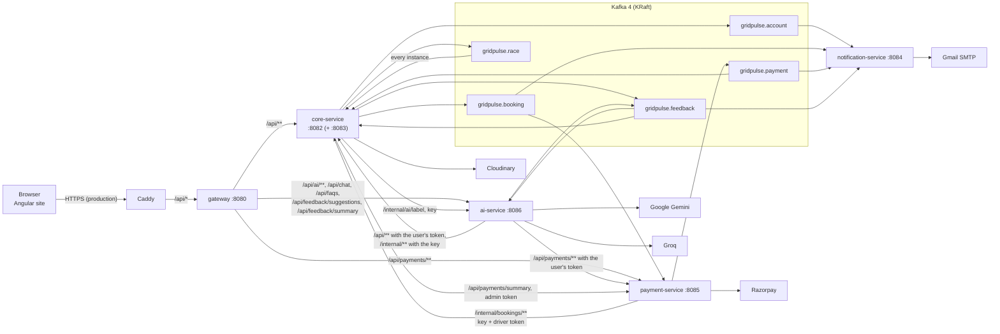

# GridPulse architecture

This page explains how the parts of GridPulse fit together: which service owns what, how they talk, and where to look
in the code when something happens. For running it see [HOW-TO-RUN.txt](../HOW-TO-RUN.txt); for production see
[DEPLOYMENT.md](DEPLOYMENT.md).

**Path shorthand.** File paths below are written from the main package of each module:

| Prefix | Folder |
|---|---|
| `core:` | `core-service/src/main/java/com/gridpulse/core/` |
| `pay:` | `payment-service/src/main/java/com/gridpulse/payment/` |
| `ai:` | `ai-service/src/main/java/com/gridpulse/ai/` |
| `notif:` | `notification-service/src/main/java/com/gridpulse/notification/` |
| `gw:` | `gateway/src/main/java/com/gridpulse/gateway/` |
| `common:` | `common/src/main/java/com/gridpulse/common/` |
| `web:` | `common-web/src/main/java/com/gridpulse/web/` |
| `ng:` | `frontend/src/app/` |

## 1. Service map

| Service | Port | Owns | Database |
|---|---|---|---|
| gateway | 8080 | the only address the browser calls: routes, CORS, rate limits; `/internal/**` always answers 403 | none |
| core-service | 8082 (a second instance on 8083 in Docker mode) | accounts, tracks, sessions, competitions, bookings, waitlist, e-tickets, race control, live boards, feedback rows, stats | `appdb` |
| payment-service | 8085 | Razorpay orders, the confirm saga with the core, refunds, the refund job | `payment_db` |
| ai-service | 8086 | the public FAQ chat, the logged-in Copilot, feedback labels, suggestions and summary | `ai_db` |
| notification-service | 8084 | every email (codes, invites, booking decisions with the e-ticket, waitlist, refunds, urgent feedback) | `notification_db` |
| `common` (jar) | - | event records, transactional outbox, idempotent inbox, JWT check, ticket PDF and QR, paging, log settings | tables in each service's own database |
| `common-web` (jar) | - | servlet security (token filter, internal key filter, role annotations) and the error body | - |

The core-service is split into feature packages: `account`, `track`, `competition`, `session`, `booking`
(with the waitlist and e-tickets), `racecontrol` (live boards), `feedback`, `stats`, `media` (Cloudinary pictures)
and `platform` (security, config, errors, the outbox listener).

## 2. Who owns which data

Rule: only the owner writes to its database. Other services ask through the owner's API or learn about changes from
events. There is one MySQL 8 server with one schema per service.

| Store | Owner | What is in it |
|---|---|---|
| `appdb` | core-service | `user`, `otp_code`, `race_track`, `race_session`, `competition`, `race_booking` (with the Razorpay order id and a copy of the payment status), `feedback` (with sentiment and urgent flag), `outbox_event`, `processed_event` |
| `payment_db` | payment-service | `payment` (with a copy of the driver and session details, so no join to the core is needed), `payment_audit`, `outbox_event`, `processed_event` |
| `ai_db` | ai-service | `faqs` (with their embedding vectors), `chat_messages`, `SPRING_AI_CHAT_MEMORY` (the Copilot's last 20 messages per chat), `pending_action` (Confirm cards), `ai_action_log`, `outbox_event`, `processed_event` |
| `notification_db` | notification-service | `processed_event` (the shared jar also creates `outbox_event`; it stays empty because this service never publishes) |
| Redis 7 | core, ai | a cache only, keys `gp:<cache>::<key>`. Core: tracks 30 s, competitions 60 s, leaderboard 5 min. ai: Gemini embeddings 24 h. With `CACHE_TYPE=none` both run without Redis. |

Tables are created and extended by Hibernate (`spring.jpa.hibernate.ddl-auto=update`). An old local database can be
tidied with `scripts/db/drop-legacy-tables.sql`.

## 3. Kafka topics

Every message is an `EventEnvelope(eventId, type, occurredAt, source, data)` in JSON (`common:event/EventEnvelope.java`).
`type` is the name of the payload record; readers skip types they do not handle and ignore unknown fields, so adding a
field never breaks an older reader. Topics have 3 partitions; the key keeps one account, booking or order in order.

| Topic | Key | Events | Producer | Consumers (group) | Retries and dead letters |
|---|---|---|---|---|---|
| `gridpulse.account` (kept 1 hour) | email | `OtpRequested`, `AdminInvited` | core | notification-service | 4 tries, waits 2 s, 6 s, 18 s; then `gridpulse.account-notification-dlt` |
| `gridpulse.booking` | booking id | `BookingDecided`, `BookingWaitlisted`, `BookingPromoted`, `BookingRefundRequested` | core | notification-service (emails), payment-service (refund requests only) | same, with `-notification-` and `-payment-` topics |
| `gridpulse.payment` | Razorpay order id | `PaymentStatusChanged` | payment | core-service (copies only REFUND_PENDING, REFUNDED, REFUND_FAILED), notification-service (email on REFUNDED) | same, `-core-` and `-notification-` topics |
| `gridpulse.race` | session id | `StandingsChanged` | core | every core instance, each in its own group `core-live-<random>`, newest messages only | none: the next change sends the whole board again |
| `gridpulse.feedback` | feedback id | `FeedbackSubmitted` (core), `FeedbackLabelled` (ai), `UrgentFeedbackReported` (core) | core, ai | ai-service (Submitted), core-service (Labelled), notification-service (Urgent) | same, `-ai-`, `-core-` and `-notification-` topics |

How a message gets there and is handled once:
- **Publish** only through `common:outbox/EventPublisher.java`. It needs a running transaction and saves the event as
  an `outbox_event` row together with the business change. In the core, services raise plain Spring events and
  `core:platform/messaging/DomainEventOutboxListener.java` writes them just before the commit.
- **Send**: `common:outbox/OutboxRelay.java` runs every 500 ms and sends unsent rows in id order. If Kafka is down the
  rows wait; the site keeps working.
- **Consume**: each listener that changes data checks `common:inbox/Inbox.java` (`isNew` before the work,
  `markProcessed` after it; where the work is a database change, both share one transaction). A second delivery of
  the same event does nothing. The live-board
  listener needs no inbox: it only pushes the current board again.
- **Give up**: after 4 tries the message goes to the service's dead-letter topic; the `@DltHandler` logs only the
  event id and type, never the payload.

## 4. Synchronous calls

The browser only calls the gateway. Services call each other only where a user is waiting for the answer.

| From | To | What | Credentials | Limits |
|---|---|---|---|---|
| gateway | core, payment, ai | the browser's request, first matching route wins (`gateway/src/main/resources/application.yml`) | passes the user's `Authorization` header on | a failed GET is retried once on another core instance; `/api/live/**` has no response timeout |
| payment-service | core | `POST /internal/bookings/check`, `POST /internal/bookings`, `GET /internal/bookings/by-order/{orderId}` | `X-Internal-Key` plus the driver's token; `by-order` needs only the key (the refund job has no user) | connect 2 s, read 5 s, breaker `core`; create and by-order are retried 2 more times |
| core-service | ai-service | `POST /internal/ai/label` (the admin's "Analyse" button) | `X-Internal-Key` | read 15 s, breaker `ai`; falls back to "not analysed" |
| core-service | payment-service | `GET /api/payments/summary` (dashboard revenue) | the admin's token | read 5 s, breaker `payment`; falls back to zeros |
| ai-service | core-service | Copilot tools on `/api/**`, `POST /internal/bookings/check`, `GET /internal/feedback/recent` (summary) | the user's token; `/internal/**` also the key | connect 2 s, read 10 s, breaker `core` |
| ai-service | payment-service | Copilot tools on `/api/payments/**` (order, payments, audit, retry refund) | the user's token | connect 2 s, read 10 s, breaker `payment` |

- `/internal/**` is checked by `web:security/InternalKeyFilter.java` (constant-time compare). The gateway never routes
  it. In production the key must be 32+ characters.
- Forwarding the user's own token means a service can never do more than the user could do in the browser.
- The calls use Spring Cloud LoadBalancer with a fixed instance list and health checks every 5 s, so only healthy
  instances get traffic (`pay:config/CoreClientConfig.java`, `ai:client/ClientConfig.java`).

## 5. Four flows, hop by hop

### A. Log in

1. `ng:site/login/login.component.ts` calls `AuthService.login` (`ng:core/services/auth.service.ts`): `POST /api/login`.
   `ng:core/interceptors/auth.interceptor.ts` sends no token, because the path is in `PUBLIC_ENDPOINTS`
   (`ng:core/constants.ts`).
2. Gateway: `gw:ratelimit/RateLimitFilter.java` allows 5 tries a minute per address, then routes to a healthy core.
3. Core: `web:security/InternalKeyFilter.java` skips (not `/internal`), `core:platform/config/JwtAuthenticationFilter.java`
   finds no token. `core:account/web/AuthController.java` calls `AuthServiceImpl.login`
   (`core:account/service/AuthServiceImpl.java`): password check with BCrypt, driver role, account enabled.
4. `core:account/security/JwtUtils.java` signs the token (HS256, valid 10 hours). It carries the user id, name and
   role, plus a short stamp of the password hash, so changing the password ends every older token in the core.
5. Angular: `UserStorageService.saveLogin` (`ng:core/services/user-storage.service.ts`) keeps the token in
   localStorage, then `/home` opens behind `ng:core/guards/auth.guard.ts`.

Every later request: the interceptor adds `Authorization: Bearer ...`; the gateway reads the user id for per-user rate
limits (`gw:ratelimit/TokenUsers.java`); the core's filter checks the token and loads the account through
`core:account/security/MyUserDetailsService.java` (a disabled account counts as logged out); then the role annotation on
the controller method (`@AdminOnly`, `@UserOnly`, `@SuperAdminOnly`, `@LoggedIn` from `web:security/`) decides.
payment-service and ai-service have no user table: `web:security/JwtTokenFilter.java` trusts the id and role in the token.

### B. Pay and register (with the 202 path and the reconciler)

1. `ng:user/register-race/user-register-race.component.ts` calls `PaymentService.createOrder`
   (`ng:core/services/payment.service.ts`): `POST /api/payments/order`. Gateway limit: 10 orders a minute per user.
2. payment-service, `pay:controller/PaymentController.java` then `PaymentServiceImpl.createOrder`
   (`pay:service/PaymentServiceImpl.java`):
   - `pay:client/CoreCalls.java` asks the core `POST /internal/bookings/check`. In the core,
     `core:booking/web/InternalBookingController.java` calls `RaceBookingServiceImpl.quote`, which runs every rule in
     `core:booking/service/BookingRules.java` (profile complete, session open, driver free, car number free) and
     saves nothing. The answer has the price and whether the driver would be waitlisted.
   - `pay:service/RazorpayServiceImpl.java` creates the Razorpay order (amount in paise).
   - `pay:service/PaymentRecordServiceImpl.java` (`openPayment`) saves the payment as CREATED with an audit row; 201.
3. `ng:core/services/payment-flow.service.ts` opens the Razorpay window. The browser pays Razorpay directly.
4. `POST /api/payments/confirm`, `PaymentServiceImpl.confirm`:
   - the HMAC-SHA256 signature proves Razorpay really said "paid"; a wrong one is 400 and nothing is booked;
   - `markCaptured` locks the payment row (`SELECT ... FOR UPDATE`), checks owner, session and status,
     moves CREATED to CAPTURED and writes `PaymentStatusChanged` to the outbox;
   - `CoreCalls.createBooking` calls `POST /internal/bookings`. The core's `RaceBookingServiceImpl.createPaidBooking`
     locks the session row, returns the existing booking if this order already has one, else checks the rules again
     and saves the booking as Pending, or Waitlisted when the session is full (then `BookingWaitlisted` is published).
5. The answer the driver gets:
   - core said 2xx: `markPaid` (PAID), 201 with the booking;
   - core said 4xx (for example the car number was taken meanwhile, or the session closed): `refundCaptured`
     (REFUND_PENDING) and the driver sees the core's own message and status;
   - no answer, 5xx or an open breaker: the payment stays CAPTURED and the driver gets **202** "Payment received. Your
     booking is being confirmed".
6. Reconciler: `pay:service/RefundJob.java` runs every 30 s. A CAPTURED payment older than one minute is looked up with
   `GET /internal/bookings/by-order/{orderId}`: found means PAID, 404 means REFUND_PENDING, no answer means "try next
   run". The same job sends waiting refunds to Razorpay and closes orders nobody paid within 15 minutes (refunding a
   late payment). Every payment ends as a booking or a refund.

### C. Admin rejects a paid booking: refund, badge and two emails

1. `ng:admin/view-registrations/admin-view-registrations.component.ts` (Reject needs a reason) calls
   `RaceService.updateRaceBooking` (`ng:core/services/race.service.ts`): `PUT /api/race-booking/{id}`.
2. Core, in one transaction: `core:booking/web/RaceBookingController.java`, then `RaceBookingServiceImpl.updateRaceBooking`
   and `changeStatus` (`core:booking/service/RaceBookingServiceImpl.java`):
   - the reason must have at least 5 characters (`BookingRules.checkReason`);
   - the booking becomes Rejected, its payment copy becomes REFUND_PENDING and `BookingRefundRequested` is raised;
   - `BookingDecided` is raised for the email (with the refund amount);
   - if the booking held a seat, the oldest Waitlisted booking moves up (`BookingPromoted`).
   `DomainEventOutboxListener` stores the events as outbox rows before the commit.
3. `OutboxRelay` sends them to `gridpulse.booking` within half a second.
4. notification-service: `notif:listener/NotificationListener.java` uses `notif:email/BookingStatusEmail.java` to
   send the rejection email.
5. payment-service: `pay:messaging/BookingEventListener.java` calls `PaymentRecordServiceImpl.refundForBooking`, which
   locks the payment, sets REFUND_PENDING and publishes `PaymentStatusChanged`.
6. The next `RefundJob` run calls Razorpay's refund, then `markRefunded` (REFUNDED) or `markRefundFailed`
   (REFUND_FAILED with the reason; the admin can press "retry refund").
7. `gridpulse.payment`: the core's `core:booking/service/PaymentEventListener.java` calls `applyPaymentStatus`
   (the badge only moves forward; REFUNDED is final), and notification-service sends `notif:email/RefundDoneEmail.java`.
8. "My Registrations" (`ng:user/view-my-registrations/user-view-my-registrations.component.ts`) reloads every 4 s and
   shows REFUNDED. Worst case about 35 s: relay, up to 30 s for the job, relay, 4 s poll.

### D. Copilot Confirm ("reject booking 42, no licence shown")

1. `ng:chat/chatbot/chatbot.component.ts` calls `CopilotService.ask` (`ng:chat/services/copilot.service.ts`):
   `POST /api/ai/copilot` with the message and the chat id. Gateway limit: 20 a minute per user.
2. ai-service: `ai:copilot/web/CopilotController.java` calls `CopilotServiceImpl.ask`
   (`ai:copilot/service/CopilotServiceImpl.java`). It takes user id and role from the token, loads the chat memory
   (conversation id `<userId>:<chatId>`), and picks the tools of that role in `ai:copilot/tools/Toolsets.java`.
3. `ai:copilot/service/GeminiChatRunner.java` sends the prompt to Gemini, moving to the next API key when one fails.
4. The model calls a read tool; `ai:client/CoreClient.java` fetches `GET /api/race-booking/42` with the admin's own token.
5. The model calls `prepareDecideBooking` in `ai:copilot/tools/AdminTools.java`. `PendingActions.prepare`
   (`ai:copilot/service/PendingActions.java`) saves a `pending_action` row: a random 32-byte token, owner id and role
   from the token (never from the model), the tool name, the arguments, a summary built from the fetched data, and an
   expiry 5 minutes ahead. Nothing has changed yet.
6. The reply carries a card with Confirm, Cancel and a countdown.
7. Confirm: `POST /api/ai/copilot/actions/{token}/confirm`. `ai:copilot/service/ActionExecutor.java` calls
   `PendingActions.claim`, which locks the row and checks it: unknown 404, another user or role 403, already used 409,
   expired 410. The card is marked used and committed first, so it can run at most once.
8. The handler registered as `decideBooking` calls `PUT /api/race-booking/42` with the admin's current token. The
   outcome goes to `ai_action_log` and back to the chat.
9. From here it is flow C from step 2: the core cannot tell a Copilot call from a click.

## 6. "When X happens, look here"

| # | When... | Frontend | Backend, in order | Afterwards |
|---|---|---|---|---|
| 1 | someone logs in | `ng:site/login/login.component.ts`, `ng:core/services/auth.service.ts` | `core:account/web/AuthController.java`, `core:account/service/AuthServiceImpl.java`, `core:account/security/JwtUtils.java` | - |
| 2 | someone signs up with an email code | `ng:site/signup/signup.component.ts` | `AuthController`, `core:account/service/OtpServiceImpl.java` | `OtpRequested`, `notif:listener/NotificationListener.java`, `notif:email/OtpEmail.java` |
| 3 | a driver browses tracks and sessions | `ng:user/view-tracks/user-view-tracks.component.ts`, `ng:site/landing/landing.component.ts` | `core:track/web/RaceTrackController.java`, `core:session/web/RaceSessionController.java` | Redis cache (`core:platform/config/CacheConfig.java`) |
| 4 | a driver pays and registers | `ng:user/register-race/user-register-race.component.ts`, `ng:core/services/payment-flow.service.ts` | `pay:controller/PaymentController.java`, `pay:service/PaymentServiceImpl.java`, `pay:client/CoreCalls.java`, `core:booking/web/InternalBookingController.java`, `core:booking/service/RaceBookingServiceImpl.java` | `PaymentStatusChanged`; `BookingWaitlisted` when full |
| 5 | an admin approves or rejects | `ng:admin/view-registrations/admin-view-registrations.component.ts`, `ng:core/services/race.service.ts` | `core:booking/web/RaceBookingController.java`, `RaceBookingServiceImpl.changeStatus` | `BookingDecided`: email, plus the e-ticket PDF (`common:ticket/TicketPdf.java`) and calendar file (`notif:ics/IcsBuilder.java`) when approved; `BookingRefundRequested` for a paid reject |
| 6 | money goes back | badge on "My Registrations" | `pay:messaging/BookingEventListener.java`, `pay:service/PaymentRecordServiceImpl.java`, `pay:service/RefundJob.java`, `pay:service/RazorpayServiceImpl.java` | `PaymentStatusChanged`: `core:booking/service/PaymentEventListener.java`, `notif:email/RefundDoneEmail.java` |
| 7 | an admin runs a race (start, laps, finish) | `ng:admin/race-control/admin-race-control.component.ts`, `ng:core/services/race-control.service.ts` | `core:racecontrol/web/RaceControlController.java`, `core:racecontrol/service/RaceControlServiceImpl.java`, `core:racecontrol/service/RaceRules.java`, `core:racecontrol/service/LiveBoardEvents.java` | `StandingsChanged`: `core:racecontrol/service/LiveBoardListener.java`, `LiveBoardHub` |
| 8 | someone watches a live board | `ng:user/live-timing/user-live-timing.component.ts`, `ng:core/services/live-board.service.ts` | gateway route `live` (no timeout), `core:racecontrol/web/LiveBoardController.java`, `core:racecontrol/service/LiveBoardHub.java` | a heartbeat every 25 s; polling every 4 s if the stream fails |
| 9 | a driver sends feedback | `ng:user/add-feedback/user-add-feedback.component.ts`, `ng:core/services/feedback.service.ts` | `core:feedback/web/FeedbackController.java`, `core:feedback/service/FeedbackServiceImpl.java` | `FeedbackSubmitted`: `ai:feedback/service/FeedbackEventListener.java`, `ai:feedback/service/GroqServiceImpl.java`; `FeedbackLabelled`: `core:feedback/service/FeedbackEventListener.java`; if urgent `UrgentFeedbackReported`: `notif:email/UrgentFeedbackEmail.java` |
| 10 | someone uses the chat bubble | `ng:chat/chat-launcher/chat-launcher.component.ts`, `ng:chat/chatbot/chatbot.component.ts`, `ng:chat/services/chat.service.ts` or `ng:chat/services/copilot.service.ts` | logged out: `ai:faq/web/ChatController.java`, `ai:faq/service/ChatServiceImpl.java`, `ai:faq/service/FaqServiceImpl.java`, `ai:gemini/GeminiServiceImpl.java`. Logged in: `ai:copilot/web/CopilotController.java`, `ai:copilot/service/CopilotServiceImpl.java`, `ai:copilot/tools/` | Confirm cards in `pending_action`, outcomes in `ai_action_log` |

## 7. Hidden control flow

Code that runs without an obvious caller.

**core-service**
- Before every commit: `core:platform/messaging/DomainEventOutboxListener.java` turns 8 kinds of events into outbox rows.
- Every 500 ms: `common:outbox/OutboxRelay.java` (also in payment and ai; switched off in notification with
  `gridpulse.outbox.relay.enabled=false`).
- Live boards: `core:racecontrol/service/LiveBoardHub.java` pushes after the commit, sends a heartbeat every 25 s and
  closes every stream when the service stops.
- Kafka listeners: `core:booking/service/PaymentEventListener.java`, `core:feedback/service/FeedbackEventListener.java`,
  `core:racecontrol/service/LiveBoardListener.java`, plus their retry and dead-letter topics.
- At start-up: `core:account/service/SuperAdminSeeder.java` creates or updates the one super admin from the settings;
  `core:platform/config/EnumColumnUpdate.java` adds new enum values to old MySQL enum columns;
  `core:platform/config/KafkaTopicConfig.java` creates the topics.
- `@PostConstruct` checks: `core:account/security/JwtUtils.java` (reads or creates the dev key file when `JWT_SECRET` is
  empty), `core:booking/service/TicketServiceImpl.java`, `core:media/service/CloudinaryServiceImpl.java`, and
  `core:platform/config/ProdSettingsCheck.java` (prod profile: refuses to start when a required secret is missing).
- Filters: `web:security/InternalKeyFilter.java` (only `/internal/**`), `core:platform/config/JwtAuthenticationFilter.java`,
  `core:platform/config/ServedByFilter.java` (dev profile: an `X-Served-By` header shows which instance answered).
- Aspect: `core:platform/aspect/GlobalLoggingAspect.java` writes one log line per failed API call, without bodies.
- Cache: `@Cacheable` in `RaceTrackServiceImpl`, `CompetitionServiceImpl` and `StatsServiceImpl`; writes evict.

**payment-service**
- Every 30 s: `pay:service/RefundJob.java` (reconcile, refund, close unpaid orders). Only one instance may run it:
  `GRIDPULSE_JOBS_REFUND_ENABLED=false` switches it off elsewhere.
- Kafka: `pay:messaging/BookingEventListener.java`.
- On every call to the core: `pay:config/CoreClientConfig.java` adds `X-Internal-Key` and the caller's token.
- `@CircuitBreaker` and `@Retry` in `pay:client/CoreCalls.java` and `pay:service/RazorpayServiceImpl.java`.

**ai-service**
- When the app is ready: `ai:faq/service/FaqServiceImpl.java` loads the 36 FAQs from
  `ai-service/src/main/resources/faqs.json` and asks Gemini for a vector only for FAQs that are new, edited or still
  without one.
- Kafka: `ai:feedback/service/FeedbackEventListener.java`.
- `ai:copilot/service/PendingActions.java` collects the cards of the current request in a ThreadLocal.
- `ai:client/ClientConfig.java` adds interceptors: the caller's token, the internal key, one circuit breaker per service.
- `ai:copilot/tools/ToolErrorProcessor.java` turns a failed tool call into one sentence for the model.
- `@EnableMethodSecurity` wraps the tool beans, so the role annotation on each `@Tool` method is enforced.
- `ai:gemini/GeminiServiceImpl.java` caches embeddings in Redis for 24 h (`@Cacheable`).

**notification-service**
- `notif:listener/NotificationListener.java`: 4 Kafka listeners (account, booking, payment, feedback) and a dead-letter handler.
- `notif:config/EmailConfig.java` tries a Gmail login in its own thread at start-up and logs the result ("EMAIL: ...").

**gateway**
- `gw:ratelimit/RateLimitFilter.java` runs first on every request. Retry for GET only; 403 for `/internal/**`;
  load-balancer health checks every 5 s.

**common and common-web**
- `common:CommonAutoConfiguration.java` is loaded automatically through
  `common/src/main/resources/META-INF/spring/org.springframework.boot.autoconfigure.AutoConfiguration.imports`. It turns on
  scheduling and adds `EventPublisher`, `Inbox`, `OutboxRelay`, the outbox and inbox tables, and a quiet Kafka producer
  listener (Spring's default one would log payloads on send errors).
- `common/src/main/resources/logback-spring.xml`: console plus one log file per day for every service.
- `web:security/TokenSecurityConfiguration.java` and `web:security/InternalKeySecurityConfiguration.java` are pulled
  in by each service's `SecurityConfig` with `@Import`.

**frontend**
- `ng:core/interceptors/auth.interceptor.ts` adds the token; a 401 logs the user out.
- 4-second reloads: the admin dashboard, the admin bookings list and "My Registrations"; the live board falls back to
  polling in `ng:core/services/live-board.service.ts`.
- `ng:chat/chat-launcher/chat-launcher.component.ts` downloads the chat code on the first click only.
- `ng:shared/ui/popup.directive.ts` opens a Material dialog while its input is set.

## 8. Known trade-offs

- **Feature packages with cycles.** The core is split by feature, but some features use each other both ways
  (`booking` and `session`, `booking` and `competition`, `booking` and `racecontrol`, `competition` and `session`,
  `platform` and `account`). It is one deployable service, so this is a tidiness issue, not a runtime one.
- **`ddl-auto=update` instead of migrations.** Hibernate adds tables and columns but never renames or removes them,
  and never changes a MySQL enum column (`EnumColumnUpdate` covers that one case). Old columns need a hand-written
  script such as `scripts/db/drop-legacy-tables.sql`. A migration tool such as Flyway would be the next step.
- **One shared HS256 key.** Every service that checks tokens holds the same secret, so each of them could also sign a
  token. Asymmetric keys (RS256, only the core signs) would remove that.
- **Tokens live 10 hours, with no refresh and no revoke list.** The core checks the account on every request, but
  payment-service and ai-service trust the role in the token until it expires. A disabled admin keeps their read
  access there for up to 10 hours.
- **Eventual consistency.** Emails, refunds, badges and labels arrive seconds after the click (worst case about 35 s
  for a refund badge). The site says so where it matters (the 202 message, "refund pending").
- **Single instances in production.** One VM runs one core, one Kafka broker (replication factor 1) and one MySQL. The
  code supports two core instances (Docker mode runs them), but a VM failure stops the site; backups are nightly.
- **In-memory state per instance.** Rate-limit buckets live in the gateway's memory and live-board viewers in each
  core's memory; a restart resets them, which is acceptable for this size.
- **AI on free tiers.** Gemini and Groq quotas are limited. The public FAQ chat is capped at 30 questions a day per
  address and falls back to word matching; the Copilot says clearly when no key is available.
